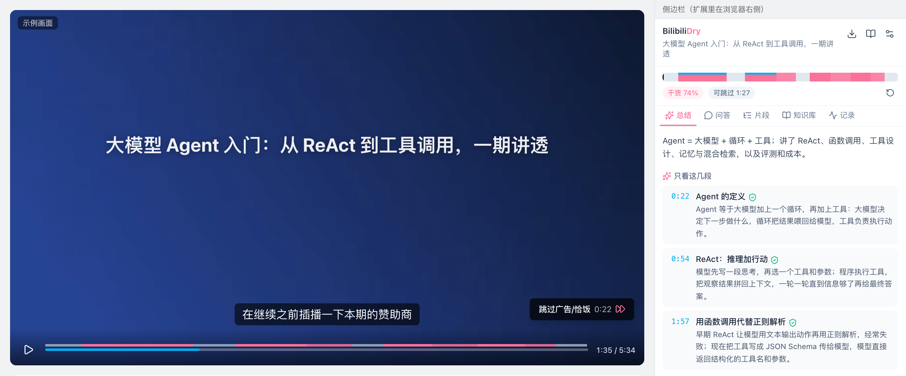
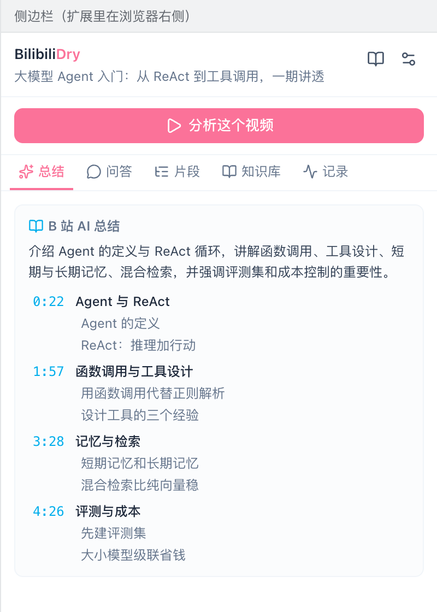
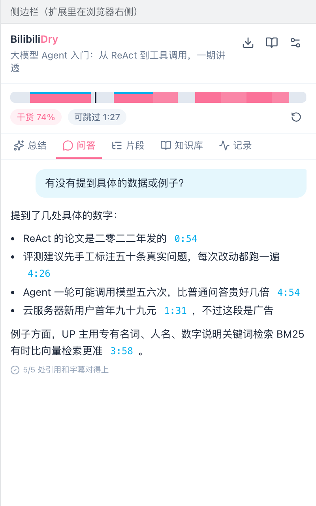
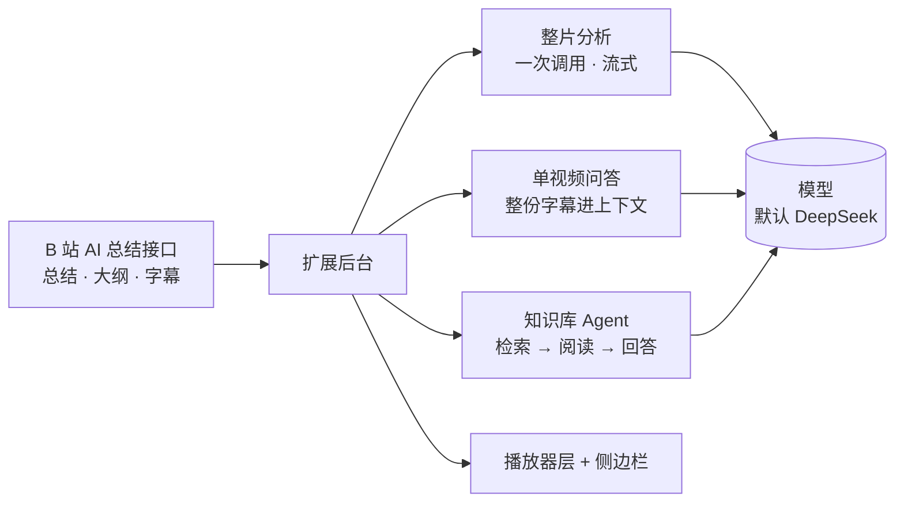

<div align="center">


# BilibiliDry

**给 B 站长视频脱水**：进度条上直接标出哪里是干货、哪里是寒暄和广告，一键跳过；有问题直接问视频，回答带可点的字幕出处。

B 站自己的 AI 总结不用配置就能看 · 配一个模型（推荐 DeepSeek，一个视频一两分钱）解锁注水识别和问答 · 没有服务器，数据只存在你的浏览器里

**[▶ 在线演示](https://crisply2404.github.io/BilibiliDry/)**：不用装扩展、不用 Key，打开就能点

</div>



| 不配 Key：B 站自己的 AI 总结 | 带字幕出处的问答 |
|---|---|
|  |  |

<sub>截图来自在线演示：扩展的代码原样运行，B 站接口和模型换成了预先准备的回应。</sub>

## 能做什么

- **进度条上标出干货和注水**：粉色越深越重要，灰色是寒暄、广告、重复、跑题，就画在 B 站自己的进度条上方，位置对得齐，全屏也在。
- **一键跳过**：放到注水段时，播放器右下角出现“跳过广告 0:22”；也可以按类型自动跳过，每次都能撤销。
- **B 站 AI 总结（不用 Key）**：B 站有总结的视频，侧边栏直接显示总结和带时间的大纲，大纲的章节点也标在进度条上。
- **只看这几段**：模型看完全片后挑出最值得看的几段（按时长 3~10 段），还有一句话总结、要点和章节。
- **问这个视频**：“他推荐的是哪个？”“有没有提到具体数据？”“现在这里在说什么？”。模型读的是整个视频的字幕，回答里每个结论后面都有出处，点一下跳到说这句话的地方；对不上字幕的出处会标黄。
- **跨视频知识库**：分析过的视频都进本地知识库。可以搜“哪个视频讲过 RRF”，也可以问 Agent“这两个视频的说法有什么不同”，它会先检索、再读原文，回答里的出处能直接跳到对应视频。
- **导出笔记**：一键导出 Markdown，时间戳都是指向原视频对应位置的链接。

## 安装

1. 到 [Releases](https://github.com/Crisply2404/BilibiliDry/releases) 下载 `bilibilidry-v*.zip` 并解压（或者自己构建，见下文）。
2. 打开 `chrome://extensions`，打开右上角“开发者模式”，点“加载已解压的扩展程序”，选择解压出来的文件夹。
3. 打开任意 B 站视频，点浏览器右上角的 BilibiliDry 图标打开侧边栏。B 站有 AI 总结的视频，这时就能看到总结。
4. 想要注水识别和问答：在设置页选服务商、填 API Key，点“保存并测试”。推荐 **DeepSeek**（`deepseek-flash`，便宜、快、中文好，一次能读完几小时的字幕）。

**关于字幕**：BilibiliDry 只读字幕，不做语音识别。B 站大部分视频有 AI 字幕，但要**登录 B 站**才能拿到；没有字幕的视频暂时无法分析。

**大概花多少钱**：用 `deepseek-flash`，分析一个 10~20 分钟的视频约 $0.002（一次调用），每次提问约 $0.0003（同一个视频连续问时字幕走缓存价）。数据来自[评测](docs/EVAL.md)。

## 隐私

- 没有后端服务器。字幕和问题只会直接发给你在设置里填的模型服务。
- API Key、分析结果、对话都存在本机（`chrome.storage.local` 和 IndexedDB），设置页可以一键清空。
- 读取 B 站字幕和 AI 总结时带上你的登录状态，只请求 B 站自己的接口，每个视频只请求一次并缓存。
- 扩展只申请 B 站相关域名的权限；模型服务的域名在你保存设置时才单独申请。

---

## 技术实现

这个项目也是一份 Agent 工程实践：先按常规做法搭了分块分析和检索式问答，再在 8 个真实 B 站视频上做对照实验，按数据改成了现在的结构。详细设计见 [docs/ARCHITECTURE.md](docs/ARCHITECTURE.md)，实验见 [docs/EVAL.md](docs/EVAL.md)。



| 关注点 | 做法 |
|---|---|
| 字幕要对 | 不签名的播放器接口会返回别的视频的字幕（实测 6 个里 4 个对不上），所以首选 B 站 AI 总结接口里与视频绑定的字幕；备用接口做 WBI 签名，并检查字幕时长和视频是否对得上 |
| 分析 | 整个视频一次调用：模型从头读到尾，逐行输出 JSON 片段，边写边上进度条。实测注水 F1 76%，原来的分块 map-reduce 是 64%，调用次数从 10 次降到 1 次，成本减半 |
| 防止编造时间 | 字幕按 `[行号\|时间]` 喂给模型，模型只返回行号，时间由程序从字幕里查 |
| 单视频问答 | 不检索，整份字幕放进上下文，引用字幕行号。和检索式 Agent 比：答对率持平，引用落在正确段 76% 对 59%，成本不到一半，快 2.7 倍；字幕在 prompt 最前面，连续提问时 83% 的输入走缓存价 |
| 跨视频知识库 | 装不进上下文，这里才用 Agent：BM25（可选向量）+ RRF + MMR 检索，读原文，引用必须落在这一轮读过的字幕里 |
| DeepSeek 适配 | 思考开关按需发送；带工具调用那一轮的思考内容按要求传回；清理偶尔混进输出的控制符；按缓存命中和高峰时段算费用 |
| 长任务 | 每出一个片段就存一次，Service Worker 被杀后从断点续跑；超长视频按上下文分窗口 |
| 可观测性 | 每次分析和问答都有 span 级 Trace：耗时、token、缓存命中、费用、错误 |
| 测试 | 50 个单元测试；真实 Chromium 里的端到端测试（模仿 B 站播放器结构的页面 + 模拟模型）；在线演示也有自己的端到端测试 |

### 开发

```bash
npm install
cp .env.example .env.local   # 填上自己的 Key，开发构建会预填到设置里
npm run dev                  # 热更新开发；Chrome 加载 dist/
npm run check                # 类型检查 + 单元测试 + 离线检索评测
npm run build && npm run e2e # 在真实 Chromium 里跑端到端测试（可用 PW_CHROMIUM 指定浏览器）
npm run eval:real            # 真实视频对比评测（需要 Key 和本地字幕数据，见 eval/real/README.md）
npm run package              # 发布构建并打包 release/bilibilidry-v*.zip（不读 .env.local，还会扫描疑似 Key）
npm run demo                 # 本地跑在线演示；npm run demo:build && npm run e2e:demo 构建并测试
```

```
src/
  core/         纯 TypeScript：B 站客户端、整片分析、问答、知识库 Agent、检索、LLM 客户端、Trace
  background/   Service Worker：数据缓存、任务调度、问答、消息路由
  content/      播放器层（进度条标注、跳过按钮）
  sidepanel/    Chrome 侧边栏
  dashboard/    知识库工作台
  options/      设置页
  ui/           共用组件与 hooks
eval/           离线检索评测、真实视频评测、对照用的旧实现（eval/baselines）
e2e/            端到端测试
demo/           在线演示（GitHub Pages）
```

## License

MIT
