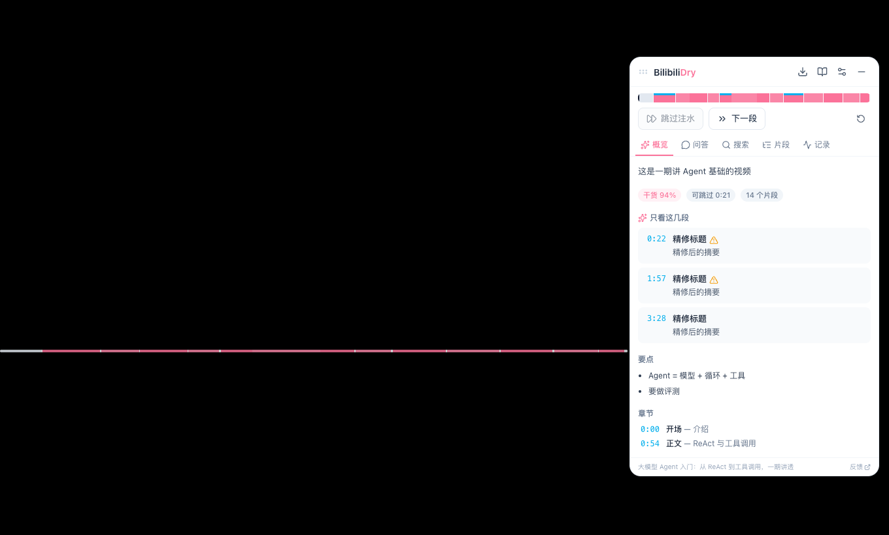
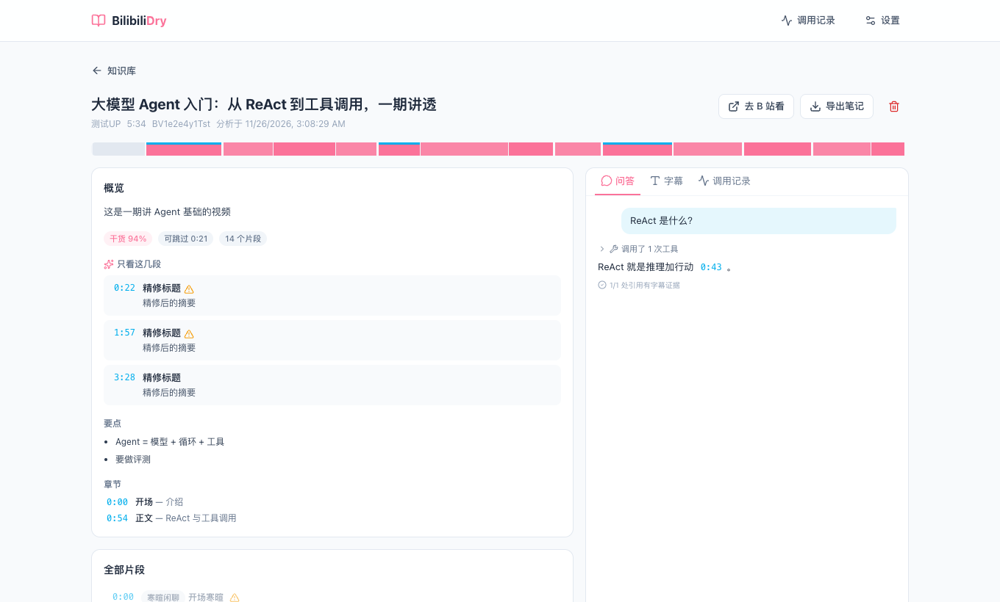
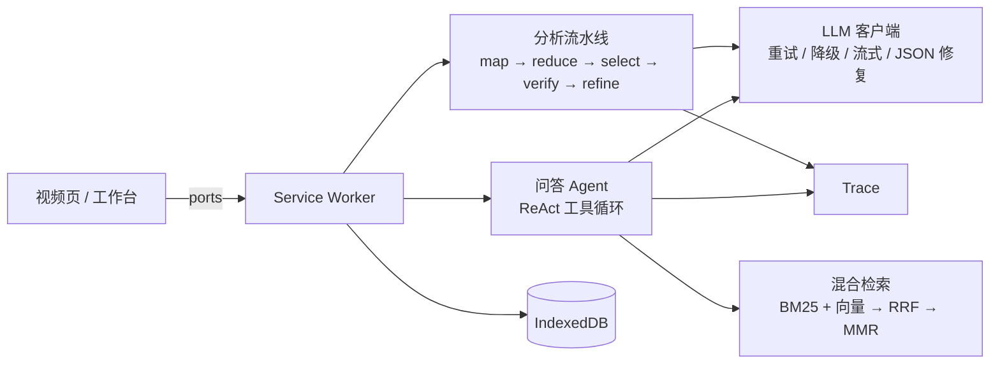

<div align="center">


# BilibiliDry

**B 站长视频 AI 脱水助手**：看一眼就知道哪里是干货、哪里能跳，有问题直接问视频，回答都带可点击的时间戳出处。

自带 Key（DeepSeek / 通义 / Kimi / 智谱 / 硅基流动 / Gemini / OpenAI / Ollama 都行）· 没有服务器 · 数据只存在你的浏览器里

**[▶ 在线演示](https://crisply2404.github.io/BilibiliDry/)**：不用装扩展、不用 Key，打开就能点

</div>

| 视频页面板 | 带出处的问答 | 知识库工作台 |
|---|---|---|
|  |  |  |

<sub>截图来自端到端测试（`npm run e2e`），内容由模拟模型生成。</sub>

## 能做什么

- **干货热力图**：播放器底部多一条细线，粉色越深越重要，灰色是寒暄、广告、重复、跑题。悬停能看到这一段讲了什么，点击直接跳过去。
- **跳过注水**：一键跳过当前注水段，也可以自动跳过你勾选的类型（广告、寒暄、重复……），每次跳过都能撤销。
- **只看这几段**：按视频时长挑出 3~10 个最值得看的片段，分散在全片，不会扎堆。每段都核对过字幕证据，证据不足会标出来。
- **章节和总结**：一句话总结、要点、章节目录。
- **问这个视频**：比如“他推荐的方案是哪个？”“有没有提到具体数据？”“这里在说什么？”。Agent 会先检索、阅读字幕再回答，每个结论后面带 `[3:25]` 这样的出处，点击就跳到那里。出处不在它查到的字幕里时会标黄。
- **跨视频知识库**：分析过的视频都会进本地知识库，可以搜“哪个视频讲过 RRF”，也可以在问答里让 Agent 去翻你以前看过的视频。
- **导出笔记**：一键导出 Markdown（总结、重点、章节、可跳过片段），每个时间戳都是指向原视频对应位置的链接，可以直接贴进 Notion 或 Obsidian。
- **长视频也稳**：分析从你正在看的位置开始，边看边出结果。中途关掉页面或浏览器，下次点“继续”从断点接着跑，不会重新花钱。

## 安装

1. 到 [Releases](https://github.com/Crisply2404/BilibiliDry/releases) 下载 `bilibilidry-v*.zip` 并解压（或者自己构建，见下文）。
2. 打开 `chrome://extensions`，打开右上角“开发者模式”，点“加载已解压的扩展程序”，选择解压出来的文件夹。
3. 安装后会自动打开设置页：选一个服务商，填 API Key，点“保存并测试”。

> 不知道选哪个？**DeepSeek** 便宜、中文好。**硅基流动**的 `BAAI/bge-m3` Embedding 免费，填上它能开启语义检索。完全离线可以用 **Ollama**。

4. 打开任意 B 站视频，右侧出现面板，点“分析这个视频”。

**关于字幕**：BilibiliDry 只读字幕，不做语音识别。B 站大部分视频有 AI 字幕，但通常**要登录 B 站**才能获取；没有任何字幕的视频暂时无法分析。

**大概花多少钱**：一个 20 分钟的视频，分块分析约 10 次调用，加上总结、核对、精修 5~10 次，输入大约 3 万 token。用 DeepSeek 一般不到一毛钱。

## 隐私

- 没有后端服务器。字幕和问题只会直接发给你在设置里填的模型服务。
- API Key、分析结果、对话都存在本机（`chrome.storage.local` 和 IndexedDB），设置页可以一键清空。
- 扩展只申请 B 站相关域名的权限；模型服务的域名在你保存设置时才单独申请。

---

## 技术实现

这个项目也是一份 Agent 工程实践：用一个真实的产品场景，把 RAG、工具调用、上下文管理、长任务恢复、评测和可观测性都落地一遍。详细设计见 [docs/ARCHITECTURE.md](docs/ARCHITECTURE.md)。



| 关注点 | 做法 |
|---|---|
| 防止模型编造时间 | 字幕按 `[行号\|时间]` 喂给模型，模型只返回行号，时间由程序从字幕里查出来 |
| 摘要是否有依据 | 先用确定性的“词面落地分”给所有片段打分（零成本）；只有落地分低的重点候选才请模型做事实核查，证据也只能给行号 |
| 选重点（替代旧版 TopK） | 重要度 × 落地分，数量按时长自适应，用 MMR 惩罚时间上相邻的候选 |
| 检索 | 40 秒重叠窗口 + 片段摘要作上下文；`Intl.Segmenter` 中文分词做 BM25；可选向量检索；用 RRF 融合，再用 MMR 去冗余 |
| Agent | 原生 function calling，4 个工具（含跨视频知识库），最多 6 步；回答中的每个引用都要落在本轮检索过的证据里；模型不支持工具调用时自动降级为单轮 RAG |
| 成本 | Model Cascade：几十次分块调用用便宜模型，总结、核查、精修、问答用主模型 |
| 长任务 | 每块分析完就写 checkpoint，先分析播放位置附近；Service Worker 被杀后可以续跑；单块失败不影响其余部分 |
| 可靠性 | 超时、指数退避重试（遵守 Retry-After）；服务商不支持 `response_format`/流式时自动降级；JSON 输出解析失败会带着错误信息让模型修一次；错误里的 Key 会被打码 |
| 可观测性 | 每次分析和问答都记录 span 级 Trace（耗时、token、错误），开发者模式下可以看时间线 |

### 评测

```bash
npm run eval -- --offline   # 不需要 Key
```

在两份带标注的字幕样例（18 个问题）上，和旧版的关键词检索对比：

| 检索方法 | Recall@1 | Recall@3 | MRR | 换说法提问 R@3 |
|---|---|---|---|---|
| v0 关键词匹配 | 72% | 78% | 0.75 | 60% |
| **BM25 + MMR（v1，无需 Key）** | **89%** | **94%** | **0.92** | **90%** |

配置模型后 `npm run eval` 还会给出注水识别 F1、重点覆盖率（对比旧版 TopK=6）、Agent 引用命中率、调用开销。方法和局限见 [docs/EVAL.md](docs/EVAL.md)。

### 开发

```bash
npm install
npm run dev         # 热更新开发；Chrome 加载 dist/
npm run check       # 类型检查 + 单元测试 + 离线评测
npm run build && npm run e2e   # 在真实 Chromium 里跑端到端测试（需要 Playwright 的 Chromium，可用 PW_CHROMIUM 指定）
npm run package     # 发布构建并打包 release/bilibilidry-v*.zip
npm run demo        # 本地跑在线演示；npm run demo:build && npm run e2e:demo 构建并测试
```

- 本地开发可以在 `.env.local` 里写 `VITE_OPENAI_BASE_URL`、`VITE_OPENAI_API_KEY`、`VITE_OPENAI_MODEL` 等变量预填设置（参考 `.env.example`）。这些值会被内联进 `npm run build` 的产物，所以只适合本机使用。`npm run package` 不读取它们，打包前还会扫描产物，发现疑似 Key 就拒绝打包。

```
src/
  core/         纯 TypeScript：分析流水线、检索、Agent、LLM 客户端、Trace（Node 里可测）
  background/   Service Worker：B 站接口、IndexedDB、任务调度、问答、消息路由
  content/      视频页面板（Shadow DOM）
  dashboard/    知识库工作台
  options/      设置页
  popup/        工具栏弹窗
  ui/           共用组件与 hooks
eval/           评测集与评测脚本
e2e/            端到端测试（fixture + 模拟模型）
demo/           在线演示（GitHub Pages）：扩展代码原样运行，B 站接口和模型换成预先准备的回应
```

## License

MIT
