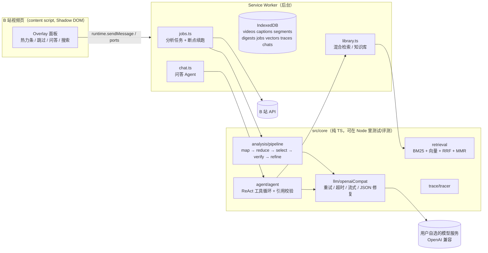

# BilibiliDry 架构与设计决策

这份文档写给想读代码、想改代码，或者想知道“为什么这么做”的人。

## 1. 总览



- **`src/core`** 不依赖任何浏览器扩展 API。分析流水线、检索、Agent、LLM 客户端、Trace 都在这里，所以单元测试和评测脚本可以直接在 Node 里跑同一份代码。
- **`src/background`** 把 core 接到 Chrome：抓字幕、存 IndexedDB、调度任务、通过 port 把进度推给页面。
- **`src/content` / `src/dashboard` / `src/options` / `src/popup`** 是四个界面，共用 `src/ui` 里的组件和 hooks。

## 2. 分析流水线

| 阶段 | 做什么 | 为什么这样做 |
|---|---|---|
| 切块 | 按 ~120 秒把字幕切块，切点选在块尾 25% 里停顿最长或句号处 | 块不重叠，每块是一个可单独重试、单独保存的 checkpoint |
| map | 每块一次调用，输出 `{from 行号, to 行号, dry/water, importance, 标题, 摘要, 要点, 注水原因}` | **模型只给行号，时间由字幕推出**，模型没法编造时间戳；返回的区间会被修成首尾相接、不重不漏 |
| 从播放位置开始 | 先分析用户正在看的那一块，再往后、最后回头 | 热力条边看边出，不用等整片分析完 |
| reduce | 一次调用，把所有片段摘要压成 TL;DR、要点、章节 | 长视频也只多一次调用 |
| 落地分 | 摘要里的实词有多少真的出现在对应字幕里（确定性计算，零成本） | 抓“模型拿常识补充了 UP 主没说的话” |
| 选重点 | 重要度 ×（0.5 + 0.5 × 落地分），数量按时长自适应（约每 4 分钟 1 个，3~10 个），用 MMR 惩罚时间上挨得太近的候选 | 取代 v0 的“按模型自报置信度取前 6 个”：自报置信度和价值无关，固定 6 个对 5 分钟和 2 小时都不对，而且前 N 往往扎堆在同一段 |
| verify | 只对落地分低于阈值的候选重点，请模型当事实核查员，证据只能给行号 | 成本跟“怀疑程度”成正比；被判 unsupported 的降级并重新选 |
| refine | 主模型只精修最终入选的重点 | Model Cascade：几十次分块调用用便宜模型，贵模型只用在几个点上 |

失败处理：某一块两次都解析失败，只记进 `failedChunks`，其余部分照常可用，界面上点“继续”只重跑失败的块。

## 3. 检索

- **检索单元**：约 40 秒的字幕窗口，步长 20 秒（相邻窗口重叠一半），每个窗口附上所在片段的标题和摘要。重叠保证答案跨边界时至少完整落在一个窗口里；附带摘要让换了说法的问题也能对上模型归纳过的措辞。
- **BM25**：`Intl.Segmenter` 做中文分词（Chrome 和 Node 自带，零体积），长词再补字二元组，弥补短查询和长文本分词不一致的问题。
- **向量**（可选）：配置了 Embedding 模型才启用，按段落缓存在 IndexedDB，模型变了自动失效。
- **融合**：RRF（只看名次，不需要把 BM25 分数和余弦相似度归一化）。
- **去冗余**：MMR，同一视频里行区间重合度高的窗口互相惩罚。

## 4. 问答 Agent

- ReAct 式工具调用循环，最多 6 步。工具：`search_transcript`、`read_transcript`、`get_outline`、`search_library`（跨视频知识库）。
- 系统提示要求：结论必须来自工具结果，并用 `[分:秒]` 标出处。
- **引用校验**：Agent 这一轮通过工具看到过的每段字幕都会被记下来；最终回答里的每个时间戳都要落在这些范围内（±8 秒）才算“有证据”。界面上没证据的引用标成橙色，并显示“x/y 处引用有字幕证据”。
- 模型不支持工具调用（400 且错误里提到 tools/function）时，自动降级为“检索一次 + 回答一次”的单轮 RAG。
- 对话记录按视频保存，最近 8 轮作为短期记忆；关闭面板会断开 port，正在进行的回答随之取消，不再继续消耗 token。

## 5. LLM 客户端

一个客户端覆盖所有 OpenAI 兼容服务：

- 超时（默认 90 秒），对 429/5xx/网络错误做指数退避加随机抖动，有 `Retry-After` 就按它等；401/400 不重试。
- 服务商拒绝 `response_format` 或 `stream` 时自动关掉对应功能重试一次，以后不再发送。
- SSE 流式解析支持增量拼接 tool call 参数。
- 结构化输出：容忍 ```json 围栏、前后夹杂文字、尾逗号；校验失败时把错误信息发回给模型修一次。
- 所有错误信息经过 `redact()`，不会把 Key 带进日志、Trace 或界面。

## 6. 可观测性

每次分析、每轮问答都是一条 Trace，每次 LLM 调用、工具调用和阶段都是一个 span，记录耗时、token（服务商没返回就按字符估算，并标记为估算值）、错误信息。开发者模式下，视频页和工作台都能看到时间线。

## 7. MV3 下的工程问题

| 问题 | 处理 |
|---|---|
| Service worker 空闲约 30 秒会被杀，长任务跟着中断 | 任务进行中每 20 秒调一次扩展 API 续命；每完成一块就写 checkpoint；worker 重启时把“运行中”的任务标成“已中断”，点“继续”从断点接着跑 |
| B 站是 SPA，切视频、切分 P 时页面不刷新 | 轮询 URL；用 `bvid_cid` 作为视频主键，分 P 不会串数据 |
| AI 字幕要登录态才能拿 | 字幕列表接口带 cookie 请求；字幕 JSON 在 CDN 上，不带 cookie 请求，避免带凭据的 CORS 问题 |
| 页面 CSS 互相污染 | 面板挂在 Shadow DOM 里，样式用 `?inline` 注入；全屏时宿主节点跟着挪进全屏元素 |
| 模型服务地址由用户填，不能预先写死权限 | `optional_host_permissions`，在设置页点“保存”时只申请那一个域名 |
| 开发时 `.env.local` 的 Key 会被内联进产物 | `npm run package` 用 `--mode release` 从空目录读 env，打包前再扫描产物，发现疑似 Key 就拒绝打包 |
| 重新分析时旧结果被半成品覆盖 | 已有结果的视频重新分析时，新结果完成前不覆盖，也不推送半成品 |

## 8. 测试与评测

- `npm test`：35 个单元测试，覆盖分词、切块、BM25/RRF/MMR、片段修正、落地分、重点选择、流水线断点续跑与失败隔离、LLM 客户端重试/降级/流式、JSON 修复、Agent 工具循环与降级、引用校验、自动跳过、Markdown 导出。
- `npm run eval -- --offline`：不需要 Key 的检索评测（见 [EVAL.md](EVAL.md)）。
- `npm run eval`：用真实模型跑完整流水线和 Agent，输出注水识别 F1、重点覆盖率、引用命中率、开销。
- `npm run e2e`：在真实 Chromium 里加载构建产物，B 站接口用 fixture 代替，模型用本地 mock 服务代替，走完“设置 → 分析 → 问答 → 搜索 → 工作台 → 导出”整条链路。
