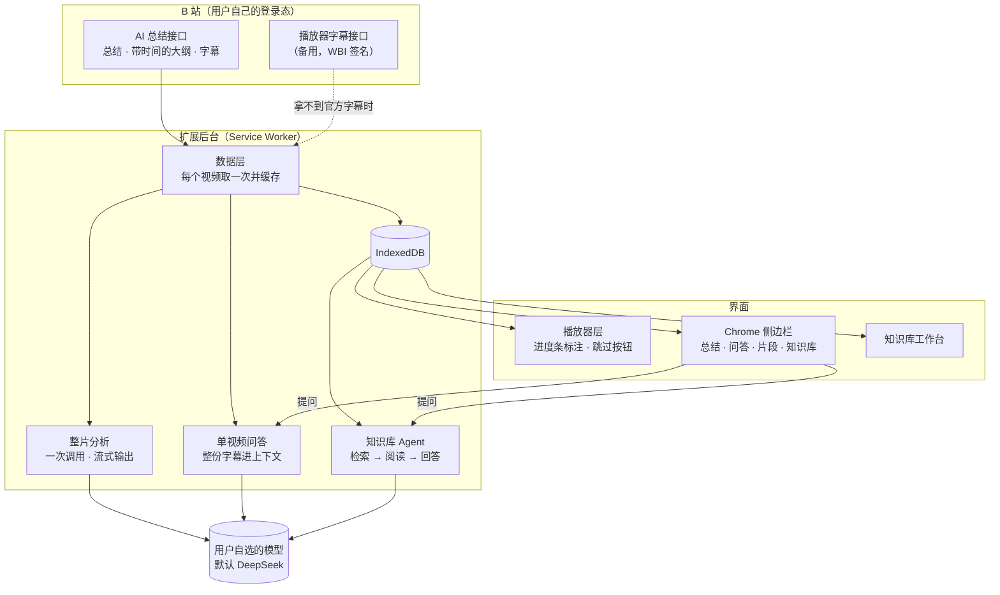

# BilibiliDry 架构与设计决策

这份文档写给想读代码、改代码，或者想知道“为什么这么做”的人。关键取舍的实验数据在 [EVAL.md](EVAL.md)。

## 1. 总览

- **数据**：优先用 B 站自己的 AI 总结接口，它一次给出总结、带时间的大纲和与视频绑定的字幕。拿不到时退回播放器字幕接口。
- **不配 Key 也能用**：B 站的总结和大纲直接显示在侧边栏，大纲的章节点标在进度条上。
- **配了 Key**：整片分析标出干货和注水、挑出重点；单视频问答和跨视频知识库带字幕出处。
- **`src/core`** 不依赖任何扩展 API：B 站客户端、分析、问答、Agent、LLM 客户端、Trace 都在这里，单元测试、评测脚本和在线演示跑的是同一份代码。

## 2. 数据层（`src/core/bilibili`）

| 问题 | 处理 |
|---|---|
| 不签名的播放器接口会返回别的视频的字幕（实测 6 个视频里 4 个对不上：长度超过视频本身、或者干脆是另一个视频的内容） | 首选 AI 总结接口，它的字幕和 bvid + cid 绑定；备用的播放器接口也做 WBI 签名，并检查字幕时长和视频时长是否对得上 |
| AI 总结接口要 WBI 签名，请求太频繁会被限流（HTTP 412，十几分钟才恢复） | 签名在本地算（WebCrypto 没有 MD5，自带一个实现），密钥 6 小时刷新一次；每个视频只请求一次 AI 总结，缓存 7 天；被限流时退回播放器字幕，不影响分析 |
| 部分视频没有 AI 总结 | 记为“没有”，侧边栏照常显示分析结果；有字幕就能分析 |

## 3. 整片分析（`src/core/analysis/analyze.ts`）

模型一次读完整个视频的字幕（每行 `[行号|时间] 文本`），按顺序逐行输出 JSON：先是一个个片段，最后是总结。

| 决策 | 原因 |
|---|---|
| 整片一次，而不是每 2 分钟一块 | “重复啰嗦”只有看过前面才判断得出来；重要度在全片用同一把尺子打分；片段不会被块边界切断。实测注水 F1 76% 对 64%，调用 1 次对 10 次，成本减半 |
| 模型只给行号，不给时间 | 时间由程序从字幕里查，模型没法编造时间戳；片段被修成首尾相接、不重不漏 |
| JSON Lines 流式输出 | 每写完一段就能解析一段，进度条边分析边出现 |
| 重点由模型在看完全片后挑 | 数量按时长给上限（约每 4 分钟 1 个，3~10 个），只接受干货段；不再用“重要度 × 落地分 + MMR”去凑 |
| B 站官方大纲作为参考输入 | 给模型一个结构提示，但以字幕为准 |
| 默认不开思考 | 浅度思考的重点更准，但耗时 4 倍、成本 2.6 倍，注水召回还下降 |
| 超长视频分窗口 | 按模型上下文估算每次能放多少字幕（DeepSeek 1M 上下文约能放 4 小时视频）；后面的窗口带上前面的片段标题，用来判断重复；最后单独做一次总结 |
| 断点续跑 | 每出一个片段就存一次；中断后从最后一个片段之后继续，走的就是分窗口那条路 |

“落地分”（摘要里的实词有多少出现在对应字幕里）照常计算，只作为界面上的提示。

## 4. 问答

### 单视频（`src/core/qa/videoQa.ts`）

一小时的 B 站视频大约 1.5 万字字幕，远小于现在模型的上下文，所以不检索，把整份字幕放进 system prompt：

- 模型看得到全部内容，不会因为检索漏召回而答不上来。
- 字幕放在 prompt 最前面，而且每次提问都完全一样，同一个视频连续提问时命中服务商的前缀缓存（实测 83% 的输入 token 走缓存价）。“当前播放到哪”这种会变的信息放在最后一条用户消息里。
- 回答引用字幕行号 `[L128]` 或 `[L128-L131]`，程序把它换成可点的时间，并检查这句话和被引的字幕在词面上是否对得上，对不上的标黄。实测这个检查只能当提示（见 EVAL.md）。

实测和检索式 Agent 相比：答对率差不多；引用落在正确段 76% 对 59%；成本不到一半；快 2.7 倍。

### 跨视频知识库（`src/core/qa/libraryAgent.ts`）

几十上百个视频装不进上下文，这里才需要 Agent：

- 工具：`list_videos`、`search_library`（BM25，可选向量，RRF 融合、MMR 去冗余，检索单元是 40 秒字幕窗口加所在片段的摘要）、`read_transcript`（读某个视频的一段原文）。
- 最多 6 步，最后一步强制作答。
- 引用写成 `[BV号 L行号]`，只有 Agent 这一轮真的读到过的行才算有证据。
- DeepSeek 开思考时要求把带工具调用那一轮的 `reasoning_content` 原样传回，否则报 400，客户端和 Agent 都处理了这一点。

## 5. 界面

| 位置 | 内容 | 为什么放这里 |
|---|---|---|
| 播放器里（content script，Shadow DOM 挂在播放器容器内） | 干货和注水画在 B 站自己的进度条上方；放到注水段时右下角出现“跳过”；自动跳过带撤销；右上角的入口按钮 | 和 B 站进度条同宽同位置，时间点对得齐；全屏时跟着播放器一起全屏 |
| Chrome 侧边栏 | 总结（B 站的和自己的）、问答、片段、知识库、调用记录 | 不遮挡 B 站页面；用户可以自己拖宽度；切视频时跟着当前标签页走 |
| 知识库工作台（独立页面） | 所有视频、全文搜索、单个视频的详情和字幕 | 需要大空间的浏览和管理 |

之前的浮动面板（380px，固定在右上角）正好盖住 B 站右栏（UP 主信息、弹幕列表、推荐），热力条也和 B 站进度条差约 12 像素对不齐，所以拆成了上面两层。

侧边栏通过点工具栏图标打开（可靠）。播放器里的按钮也会尝试打开它，但 Chrome 对网页触发 `sidePanel.open()` 的限制较多，打不开时提示用户点图标。

## 6. LLM 客户端（`src/core/llm`）

一个客户端覆盖所有 OpenAI 兼容服务：

- 超时、对 429/5xx/网络错误指数退避（遵守 `Retry-After`）、401/400 不重试。
- 服务商拒绝 `response_format` 或流式时自动关掉对应功能重试。
- SSE 流式解析，支持增量拼接 tool call 参数。
- DeepSeek：
  - 思考开关用 `thinking` 和 `reasoning_effort` 控制，只发给认识这两个参数的服务商；
  - 带工具调用那一轮的 `reasoning_content` 会传回；
  - 偶尔混进输出的 `<|endoftext|>` 这类控制符会被清掉（实测出现在 JSON 里导致解析失败）。
- 用量统计里有缓存命中 token 和思考 token，按已知价格（DeepSeek 区分高峰时段）算出每次调用的费用。
- 所有错误信息经过 `redact()`，Key 不会进日志、Trace 或界面。

## 7. 可观测性

每次分析、每次问答都是一条 Trace，每次模型调用、工具调用都是一个 span，记录耗时、token、缓存命中、费用和错误。开发者模式下，侧边栏和工作台都能看到。

## 8. MV3 下的工程问题

| 问题 | 处理 |
|---|---|
| Service worker 空闲约 30 秒会被杀，长任务跟着中断 | 任务进行中每 20 秒调一次扩展 API 续命；每出一个片段就存一次；worker 重启时把“运行中”的任务标成“已中断”，点“继续”接着跑 |
| B 站是 SPA，切视频、切分 P 时页面不刷新 | 轮询 URL；用 `bvid_cid` 作为视频主键，分 P 不会串数据；播放器被重建时重新挂载播放器层 |
| 页面 CSS 互相污染 | 播放器层在 Shadow DOM 里，样式用 `?inline` 注入；进度条标注只用内联样式 |
| 模型服务地址由用户填，不能预先写死权限 | `optional_host_permissions`，在设置页点“保存”时只申请那一个域名 |
| 开发时 `.env.local` 的 Key 会被内联进产物 | 发布打包和在线演示都从空目录读 env，构建后扫描产物，发现疑似 Key 就拒绝 |
| 重新分析时旧结果被半成品覆盖 | 已有结果的视频重新分析时，新结果完成前不覆盖，也不推送半成品 |

## 9. 测试与评测

- `npm test`：50 个单元测试，覆盖 WBI 签名、字幕来源选择和校验、整片分析（流式解析、片段修正、分窗口、断点续跑）、问答和引用核对、知识库 Agent（工具循环、思考内容回传、步数上限）、LLM 客户端（重试、降级、流式、DeepSeek 参数、费用）、检索、自动跳过、Markdown 导出。
- `npm run eval`：不需要 Key 的检索评测，CI 每次都跑。
- `npm run eval:real`：真实视频上的对比评测（见 [EVAL.md](EVAL.md)）。
- `npm run e2e`：在真实 Chromium 里加载构建好的扩展。B 站页面模仿播放器结构、接口用 fixture、模型用本地模拟服务，走完“B 站总结 → 整片分析 → 进度条标注 → 跳过 → 问答 → 知识库 → 工作台 → 导出”。
- `npm run e2e:demo`：测在线演示（见下一节）。

## 10. 在线演示

[在线演示](https://crisply2404.github.io/BilibiliDry/)让人不装扩展、不配 Key 也能点一遍完整流程。它把扩展的代码原样放进普通网页里跑：

| 部分 | 演示里是什么 |
|---|---|
| 后台、分析、问答、Agent、Trace、IndexedDB、播放器层、侧边栏、工作台 | 原样运行，和扩展是同一份代码 |
| `chrome.*` API | `demo/src/chromeShim.ts`：消息、port、`storage`、`tabs`、`sidePanel` 的最小实现。和 Chrome 一样，页面发出的 `runtime.sendMessage` 只到后台，`tabs.sendMessage` 只到页面 |
| B 站播放器 | 演示页用和 B 站一样的类名搭了一个播放器，播放器层的代码照常找到它并标注进度条 |
| B 站接口 | `demo/src/fakeNetwork.ts`：用两份原创字幕模拟 AI 总结接口 |
| 大模型 | `demo/src/scriptedModel.ts`：按 OpenAI 协议回应（JSON、SSE 流式、tool calls）。分析结果和几个常见问题的回答是事先按字幕写好的；没准备的问题会列出字幕里最相关的几句，并说明这一点 |

模拟模型靠扩展自己的提示词识别请求类型，改提示词时要同步改它；`npm run e2e:demo` 会在 CI 里把访客的路径走一遍，防止演示悄悄坏掉。
