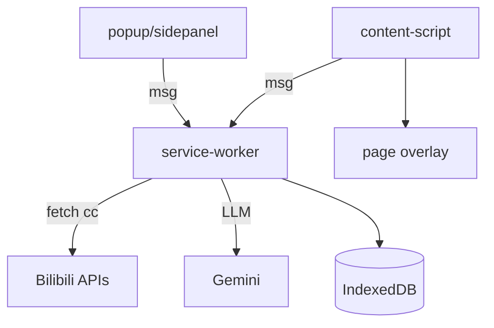

# 技术设计: Chrome 插件 MVP（纯扩展本地化）

## 技术方案

### 核心技术
- Chrome Extension MV3（content scripts + service worker）
- React + TypeScript + Vite（用于 popup/sidepanel/设置页与部分组件复用）
- Gemini API（BYOK，扩展端直连）
- IndexedDB（segments + embeddings + videos）

### 实现要点
- **Key 管理:** API Key 仅保存在 `chrome.storage.local`，只允许 service worker 读取；content script 通过 message 请求能力，不直接拿到 Key
- **字幕获取（仅 CC）:**
  - 首选：从页面提取 `bvid/aid/cid` → 调用 B站字幕接口获取字幕文件 URL（带时间戳）
  - 备选：页面 DOM 侧抓取（如播放器字幕轨道可读时）
  - 失败回退：提示“无字幕/不可访问”，只提供基础功能入口
- **增量分析（边看边出）:**
  - 将字幕按时间窗口切成 chunks（60-120s）
  - 调用 Flash 模型先产出 `segments[]`（优先可跳过信息）
  - 先写入 segments 并更新热力图；再异步补 embedding 与更精细摘要
- **注水跳过:**
  - 使用 `segments` 生成可跳过区间
  - “一键跳过”：seek 到 next DRY
  - “自动跳过”：进入 WATER 自动 seek（可在设置中开关）
- **跨视频检索:**
  - embedding 文本优先使用 `segment.summary`，必要时拼接短原文（不建议存全量）
  - MVP 采用线性扫描 cosine；后续升级 ANN（如 HNSW WASM）
- **导出:**
  - 按 `overallSummary + logicBlocks + segments` 渲染 Markdown
  - 提供复制按钮与下载 `.md`

---

## 架构设计

---

## 架构决策 ADR

### ADR-001: 纯扩展本地化 + BYOK，不托管后端
**上下文:** 用户希望“只装扩展”、并且“用户自备 key”，同时要做记忆与跨视频检索。托管后端会引入信任/成本/合规与部署阻力。
**决策:** 方案 1：扩展端直连模型 API，记忆与检索全部本地化（IndexedDB）。
**理由:** 交付阻力最低；隐私友好；MVP 可在一周内完成可演示作品。
**替代方案:** 扩展 + 托管后端 → 拒绝原因：用户 Key 传后端风险高；用户额外依赖服务端可用性。
**影响:** 后端 JD 的“部署/运维”亮点不足，需要在作品叙事中强调“Memory/RAG/Tooling 的工程化实现”，并可额外准备“可选后端增强版”（仅用于面试展示，非默认交付）。

### ADR-002: 本地向量检索 MVP 先线性扫描
**上下文:** 一周交付期内，数据规模预计较小（个人学习视频几十个以内）。
**决策:** MVP 采用线性扫描 cosine 相似度；抽象接口为 `VectorStore`，预留 ANN 升级点。
**理由:** 实现简单可控；先把“闭环体验”做出来；后续可优化。
**替代方案:** HNSW/FAISS/WASM → 拒绝原因：工程复杂度高，容易拖慢 MVP。
**影响:** 需要缓存与分批加载，避免 UI 卡顿；对数据规模增长设置上限提示。

---

## API设计
见 `helloagents/wiki/api.md`（内部 message API 契约）。

---

## 数据模型
见 `helloagents/wiki/data.md`（IndexedDB schema）。

---

## 安全与性能

- **安全:**
  - API Key 仅存在 `chrome.storage.local`，禁止写入 IndexedDB
  - message 通道需做来源校验（仅允许本扩展与特定 tab）
  - 最小权限原则：只申请 `https://www.bilibili.com/*` 与必要 API 域名权限
  - 提供“一键清空本地记忆/删除某视频记录”
- **性能:**
  - chunk 分析并发限制（默认 1-2）
  - 缓存：同一视频同一 chunk 的分析结果缓存（避免重复扣费）
  - 首屏优先：先产出 segments（跳过可用），再产出 embedding/逻辑积木
  - 可取消：用户离开页面/关闭功能时中止任务

---

## 测试与部署

- **测试:**
  - 单元测试：分块/合并 segments、跳过策略、cosine 检索排序
  - 冒烟测试：在一个公开视频页面验证字幕抓取、热力图渲染、跳过可用、导出可用
- **部署:**
  - `pnpm|npm build` → 产物打包为 MV3 扩展目录
  - 开发期用 `chrome://extensions` 加载 unpacked

