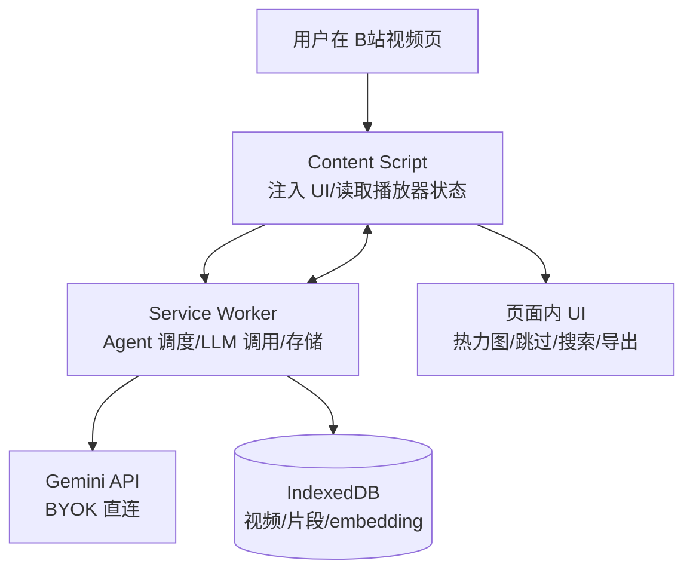
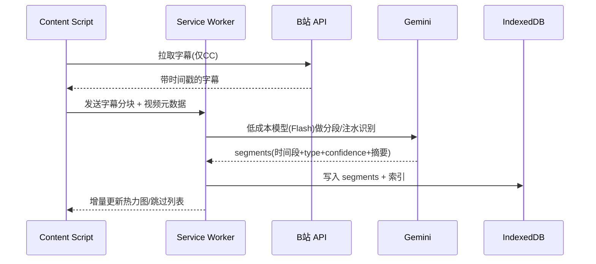

# 架构设计

## 总体架构

---

## 技术栈
- **扩展:** Chrome MV3
- **前端:** React + TypeScript + Vite
- **数据:** IndexedDB（向量/片段索引），`chrome.storage`（配置）
- **LLM:** Gemini（用户 API Key）

---

## 核心流程

### 1) “边看边出”增量分析

### 2) 一键跳过注水

- Content Script 持有当前播放时间 `t`
- 查找 `t` 所在 segment；若为 `WATER`，跳到下一个 `DRY` 的 `startTime`
- 可选“自动跳过”模式：进入 `WATER` 自动 seek

### 3) 跨视频搜索（本地语义记忆）

- 对 `DRY` segments 的摘要/原文生成 embedding
- 查询时生成 query embedding，做 cosine 相似度排序（MVP 用线性扫描；后续可升级 ANN）
- 返回：视频标题 + 时间戳 + 片段摘要，支持一键跳转到播放器

---

## 重大架构决策

| adr_id | title | date | status | affected_modules | details |
|--------|-------|------|--------|------------------|---------|
| ADR-001 | 纯扩展本地化 + BYOK，不托管后端 | 2026-01-27 | ✅已采纳 | extension/agent/memory | 方案包 `helloagents/plan/202601270145_chrome_extension_mvp/how.md` |
| ADR-002 | 本地向量检索 MVP 先线性扫描 | 2026-01-27 | ✅已采纳 | memory | 同上 |

